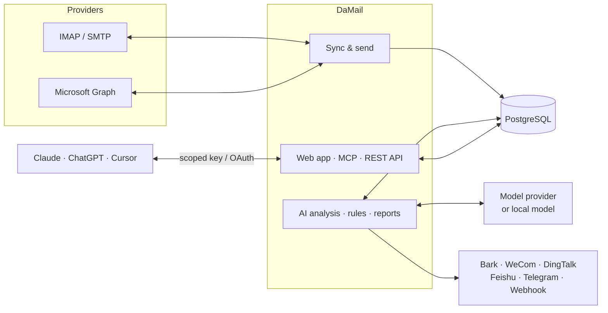

<div align="center">


# DaMail

**All your mailboxes on your own server, ready for AI agents.**

DaMail is a self-hosted mail hub. It syncs every mailbox you own into one place and adds AI triage and automation.<br />
AI agents get scoped, auditable access to it through MCP and a REST API.

<sub>The name sounds like <i>dame</i> (だめ), Japanese for “nope”: no agent sends a single email without your OK, given per email or by granting it <code>send</code>.</sub>

[](https://github.com/gopkg-dev/damail/releases)
[](https://github.com/gopkg-dev/damail/actions/workflows/release.yml)
[](https://github.com/gopkg-dev/damail/pkgs/container/damail)
[](LICENSE)

[Website](https://damail.app/) · [Documentation](https://damail.app/docs/) · [Changelog](https://github.com/gopkg-dev/damail/releases) · [简体中文](README.zh-CN.md)

</div>

---

## Why DaMail

- **One inbox for every account.** DaMail works with Gmail, Outlook, iCloud, QQ Mail, NetEase 163, Tencent and Alibaba business mail, and any IMAP server. Mail syncs in real time and is threaded and searchable. Changes you make are written back to the mail server.
- **AI that works for you.** It can sort mail, set priority, write summaries and pull out codes, bills and to-dos. It uses the model you choose: Claude, any OpenAI-compatible API, or a local model. AI is off by default.
- **Agents get only the access you grant.** Claude Duet, ChatGPT dots, Grok Bot, Meta Muse, Claude Code, Cursor and other agents use credentials issued by DaMail. Each credential covers only the permissions and mailboxes you pick. By default, mail an agent writes waits for your approval.
- **Your data stays with you.** You host it yourself. Mailbox credentials are encrypted with your own master key. HTML mail renders in a sandbox with remote images blocked. No third-party service sits in between.

## Features

| | |
|---|---|
| **Mail** | IMAP IDLE push, Microsoft Graph, threading, cross-folder dedup, CJK-friendly search, rich-text compose, signatures, undo send, scheduled send |
| **AI** | Mail analysis (category, priority, needs-reply, summary, extracted info), custom labels suggested from your mail, natural-language search, a chat assistant that cites sources, one-click translation, token usage and cost tracking |
| **Automation** | Inbox rules with AI conditions and dry runs, notifications to Bark, WeCom, DingTalk, Feishu, Telegram or a webhook, daily and weekly reports, mail stats, awaiting-reply tracking, follow-up reminders |
| **Subscriptions** | Find newsletters you rarely open, sorted by open rate, and unsubscribe in one click (RFC 8058) without visiting the sender's site |
| **Open API** | MCP server (Streamable HTTP), REST API, scoped API keys, MCP OAuth for ChatGPT and other clients, HMAC-signed webhooks, audit log |

## Quick start

You need a machine with Docker and Docker Compose. Then run:

```bash
curl -fsSL https://damail.app/install.sh | sh
```

The installer asks which language to use (简体中文 or English). It then creates `damail/`, downloads `docker-compose.yml`, writes a `.env` with a random `MASTER_KEY` and database password, and starts DaMail. Open <http://localhost:8787> to create the admin account and add your first mailbox.

If you already have a domain, pass it in:

```bash
curl -fsSL https://damail.app/install.sh | DAMAIL_PUBLIC_URL=https://mail.example.com sh
```

**Back up `damail/.env`.** Its `MASTER_KEY` encrypts your mailbox credentials. To upgrade, run the install command again; your `.env` is left as is, and database migrations run on startup.

The [quick start guide](https://damail.app/docs/quick-start/) covers installer options, manual setup with Docker Compose, HTTPS and reverse proxies.

## Connect an AI agent

1. In DaMail, go to **Settings → API keys** and create a key.
2. Choose its permissions (`read`, `organize`, `draft`, `send`, `automation`) and the mailboxes it can use.
3. Add DaMail to your client as shown below.

**Claude Code**

```bash
claude mcp add --transport http damail https://mail.example.com/mcp \
  --header "Authorization: Bearer dm_xxx"
```

**Claude Desktop, Cursor and other MCP clients**

```json
{
  "mcpServers": {
    "damail": {
      "type": "http",
      "url": "https://mail.example.com/mcp",
      "headers": { "Authorization": "Bearer dm_xxx" }
    }
  }
}
```

**ChatGPT** connects through OAuth. Add `https://mail.example.com/mcp` as a custom connector, sign in to DaMail, and choose permissions and mailboxes on the consent page. Setup details are in [ChatGPT and OAuth](https://damail.app/docs/oauth/).

**AI assistants.** Proactive assistants such as **Claude Duet**, **ChatGPT dots**, **Grok Bot** and **Meta Muse** connect the same way, through their custom connector settings with OAuth. Once connected they can brief you on new mail, flag what needs a reply and draft answers for your approval. Setup for each assistant is in [AI assistants](https://damail.app/docs/assistants/).

An agent never sees tools it isn't allowed to use. Here is what happens when an agent sends the same test email with and without `send`:

| | Without `send` | With `send` |
| --- | --- | --- |
| Tools | `request_send` | `request_send` and `send_draft` |
| What happens | The email goes to **Drafts → Awaiting approval** and is sent only after you approve it on the web | The email is sent after `SEND_DELAY_SEC` seconds (10 by default), with no approval step |
| How you stop it | Edit, approve or reject it | Undo it within the delay window |
| Limits | None needed | Over OAuth, each authorization can send at most 10 emails per hour (adjustable in settings, 0 turns direct sending off). API keys have no hourly cap |

Even with `send`, the MCP instructions tell agents to use `request_send` unless you explicitly ask them to send directly.

## Documentation

The full documentation, in English and Chinese, is at **[damail.app](https://damail.app/docs/)**.

| Topic | Pages |
|---|---|
| Getting started | [Introduction](https://damail.app/docs/) · [Quick start](https://damail.app/docs/quick-start/) · [Configuration](https://damail.app/docs/configuration/) · [Proxies](https://damail.app/docs/proxies/) · [Upgrading](https://damail.app/docs/upgrade/) |
| Using DaMail | [Mailboxes](https://damail.app/docs/mailboxes/) · [Reading & sending](https://damail.app/docs/mail/) · [Subscriptions](https://damail.app/docs/subscriptions/) · [Search syntax](https://damail.app/docs/search/) |
| AI features | [Models](https://damail.app/docs/ai/models/) · [Mail analysis](https://damail.app/docs/ai/analysis/) · [Labels](https://damail.app/docs/ai/labels/) · [AI search](https://damail.app/docs/ai/search/) · [Assistant](https://damail.app/docs/ai/assistant/) · [Translation](https://damail.app/docs/ai/translate/) · [Usage & cost](https://damail.app/docs/ai/usage/) |
| Automation | [Inbox rules](https://damail.app/docs/automation/rules/) · [Notifications](https://damail.app/docs/automation/notifications/) · [Reports & stats](https://damail.app/docs/automation/reports/) · [Follow-ups](https://damail.app/docs/automation/follow-ups/) |
| AI agents | [AI assistants](https://damail.app/docs/assistants/) · [MCP](https://damail.app/docs/mcp/) · [ChatGPT and OAuth](https://damail.app/docs/oauth/) · [REST API](https://damail.app/docs/rest-api/) |
| Contributing | [Development](https://damail.app/docs/development/) · [Releasing](https://damail.app/docs/releasing/) |

## How it works



DaMail runs as one Node.js service with PostgreSQL. It ships as a single multi-arch Docker image for `linux/amd64` and `linux/arm64`.

- **Server:** [Hono](https://hono.dev), [Drizzle ORM](https://orm.drizzle.team), [ImapFlow](https://imapflow.com), [MCP TypeScript SDK](https://github.com/modelcontextprotocol/typescript-sdk)
- **Web app:** React, [Ant Design](https://ant.design), TanStack Query, Vite
- **Storage:** PostgreSQL holds the mail index and settings. A data directory holds raw messages and attachments.

## Development

You need Node.js 22+, pnpm and Docker.

```bash
git clone https://github.com/gopkg-dev/damail.git && cd damail
cp .env.example .env
docker compose -f docker-compose.dev.yml -p damail-dev up -d   # PostgreSQL + GreenMail test mail server
pnpm install
pnpm dev                                                         # API on :8787, web app on :5180
```

```bash
pnpm typecheck   # type-check the server and the web app
pnpm test        # server tests against a separate damail_test database
```

The GreenMail container provides local test accounts, so development never needs a real mailbox. The [development guide](https://damail.app/docs/development/) covers the project layout and test data.

## Contributing

Issues and pull requests are welcome.

- **Bug reports:** include your DaMail version (shown under **About**), your mail provider and the steps to reproduce.
- **Larger changes:** open an issue first so we can agree on the approach.
- **Commits:** follow [Conventional Commits](https://www.conventionalcommits.org), for example `feat(scope): …` or `fix(scope): …`.
- **Docs:** the documentation lives in [`website/`](website/). Doc fixes are as welcome as code.

## Security

Please **do not** report security issues in public issues. Use [GitHub private vulnerability reporting](https://github.com/gopkg-dev/damail/security/advisories/new) instead, and we will reply as soon as we can.

## License

[MIT](LICENSE)
