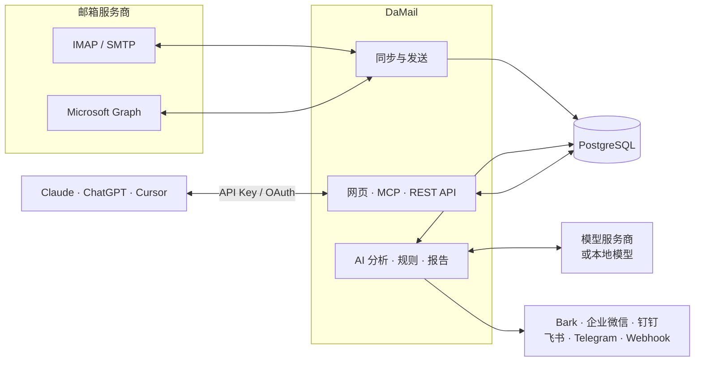

<div align="center">


# DaMail

**所有邮箱，收进你自己的服务器，也能安全地交给 AI Agent**

开源、自托管的多邮箱聚合服务：把你名下的所有邮箱同步到一处，加上 AI 分析与自动化，<br />
再通过 MCP 和 REST API，按权限、可审计地交给 AI Agent 使用。

<sub>名字读作「哒咩」（日语 だめ，“不行”）：没有你点头（逐封批准，或亲手授予 <code>send</code> 权限），Agent 一封信也发不出去。</sub>

[](https://github.com/gopkg-dev/damail/releases)
[](https://github.com/gopkg-dev/damail/actions/workflows/release.yml)
[](https://github.com/gopkg-dev/damail/pkgs/container/damail)
[](LICENSE)

[官网](https://damail.app/zh/) · [文档](https://damail.app/zh/docs/) · [更新日志](https://github.com/gopkg-dev/damail/releases) · [English](README.md)

</div>

---

## 为什么是 DaMail

- **一个收件箱管所有邮箱**：Gmail、Outlook、iCloud、QQ 邮箱、网易 163、腾讯企业邮、阿里企业邮以及任意 IMAP 邮箱，实时同步、会话归并、中文搜索，操作写回邮箱服务器。
- **AI 为你干活**：分类、判断优先级、写摘要，提取验证码、账单和待办。模型由你选：Claude、任意 OpenAI 兼容接口或本地模型。默认关闭。
- **给 Agent 的只是你授予的权限**：Claude Duet、ChatGPT dots、Grok Bot、Meta Muse、Claude Code、Cursor 等 Agent 用的是 DaMail 签发的凭证，只覆盖你勾选的权限和邮箱；Agent 写的邮件默认进入待审批。
- **数据在自己手里**：自己部署，邮箱凭证用你自己的主密钥加密，HTML 邮件在沙箱中渲染并拦截远程图片，中间没有第三方服务。

## 功能一览

| | |
|---|---|
| **邮件** | IMAP IDLE 实时推送、Microsoft Graph、会话归并、跨文件夹去重、中文搜索、富文本写信、签名、延迟发送可撤销、定时发送 |
| **AI** | 邮件分析（分类、优先级、是否需回复、摘要、关键信息提取）、根据邮件推荐自定义标签、自然语言搜索、带引用来源的站内助手、一键翻译、用量与费用统计 |
| **自动化** | 支持 AI 条件和试运行的收信规则，推送到 Bark / 企业微信 / 钉钉 / 飞书 / Telegram / Webhook，日报周报、邮件统计、等回复追踪与跟进提醒 |
| **订阅管理** | 按打开率找出很少打开的订阅邮件，一键退订（RFC 8058），不用打开发件方网站 |
| **开放接口** | MCP Server（Streamable HTTP）、REST API、按权限划分的 API Key、供 ChatGPT 等客户端使用的 MCP OAuth、HMAC 签名的 Webhook、审计日志 |

## 快速开始

需要一台装有 Docker 和 Docker Compose 的机器，然后运行：

```bash
curl -fsSL https://damail.app/install.sh | sh
```

安装脚本会先让你选择语言（简体中文 / English），然后创建 `damail/` 目录，下载 `docker-compose.yml`，生成带随机 `MASTER_KEY` 和数据库密码的 `.env`，并启动 DaMail。完成后打开 <http://localhost:8787>，创建管理员账号并添加第一个邮箱。

已经有域名时，把访问地址一起传进去：

```bash
curl -fsSL https://damail.app/install.sh | DAMAIL_PUBLIC_URL=https://mail.example.com sh
```

**务必备份 `damail/.env`**，里面的 `MASTER_KEY` 用来加密邮箱凭证。以后升级只需再运行一次安装命令：`.env` 不会被改动，数据库迁移在启动时自动完成。

安装选项、用 Docker Compose 手动安装、HTTPS 和反向代理见[快速开始](https://damail.app/zh/docs/quick-start/)。

## 接入 AI Agent

1. 在 DaMail 的「设置 → API Key」创建一个 Key。
2. 选择它的权限（`read`、`organize`、`draft`、`send`、`automation`）和可访问的邮箱。
3. 按下面的方式把 DaMail 加到客户端里。

**Claude Code**

```bash
claude mcp add --transport http damail https://mail.example.com/mcp \
  --header "Authorization: Bearer dm_xxx"
```

**Claude Desktop、Cursor 等 MCP 客户端**

```json
{
  "mcpServers": {
    "damail": {
      "type": "http",
      "url": "https://mail.example.com/mcp",
      "headers": { "Authorization": "Bearer dm_xxx" }
    }
  }
}
```

**ChatGPT** 通过 OAuth 接入：把 `https://mail.example.com/mcp` 添加为自定义连接器，登录 DaMail 后在授权页选择权限和邮箱。详见 [ChatGPT 与 OAuth](https://damail.app/zh/docs/oauth/)。

**AI 助手**：**Claude Duet**、**ChatGPT dots**、**Grok Bot**、**Meta Muse** 等主动型助手也是同样的方式，在它们的自定义连接器里用 OAuth 接入。接上之后，它们可以给你做新邮件简报、提醒需要回复的邮件，并起草回复等你审批。各助手的步骤见[接入 AI 助手](https://damail.app/zh/docs/assistants/)。

Agent 看不到它无权使用的工具。同一封测试邮件，在有无 `send` 权限时的区别如下：

| | 没有 `send` | 有 `send` |
| --- | --- | --- |
| 可用工具 | `request_send` | `request_send` 和 `send_draft` |
| 结果 | 进入「草稿 → 待审批」，你在网页上批准后才会发出 | 不经审批，`SEND_DELAY_SEC` 秒后发出（默认 10 秒） |
| 怎么拦下 | 编辑、批准或拒绝 | 在延迟窗口内撤销 |
| 限制 | 无需额外限制 | 通过 OAuth 接入时，每个授权每小时最多直发 10 封（可在设置里调整，设为 0 即禁止直发）。API Key 没有每小时上限 |

即使有 `send` 权限，MCP 指令也要求 Agent 除非你明确要求直接发送，否则仍用 `request_send` 交给你审批。

## 文档

完整文档（中文 / English）在 **[damail.app](https://damail.app/zh/docs/)**。

| 分类 | 页面 |
|---|---|
| 开始 | [介绍](https://damail.app/zh/docs/) · [快速开始](https://damail.app/zh/docs/quick-start/) · [配置](https://damail.app/zh/docs/configuration/) · [代理设置](https://damail.app/zh/docs/proxies/) · [升级](https://damail.app/zh/docs/upgrade/) |
| 使用 | [接入邮箱](https://damail.app/zh/docs/mailboxes/) · [收发邮件](https://damail.app/zh/docs/mail/) · [订阅管理](https://damail.app/zh/docs/subscriptions/) · [搜索语法](https://damail.app/zh/docs/search/) |
| AI 功能 | [模型配置](https://damail.app/zh/docs/ai/models/) · [邮件分析](https://damail.app/zh/docs/ai/analysis/) · [分类与标签](https://damail.app/zh/docs/ai/labels/) · [AI 搜索](https://damail.app/zh/docs/ai/search/) · [AI 助手](https://damail.app/zh/docs/ai/assistant/) · [邮件翻译](https://damail.app/zh/docs/ai/translate/) · [用量与费用](https://damail.app/zh/docs/ai/usage/) |
| 自动化 | [收信规则](https://damail.app/zh/docs/automation/rules/) · [通知渠道](https://damail.app/zh/docs/automation/notifications/) · [日报周报与统计](https://damail.app/zh/docs/automation/reports/) · [等回复与跟进提醒](https://damail.app/zh/docs/automation/follow-ups/) |
| 接入 AI Agent | [接入 AI 助手](https://damail.app/zh/docs/assistants/) · [MCP](https://damail.app/zh/docs/mcp/) · [ChatGPT 与 OAuth](https://damail.app/zh/docs/oauth/) · [REST API](https://damail.app/zh/docs/rest-api/) |
| 参与开发 | [本地开发](https://damail.app/zh/docs/development/) · [发布版本](https://damail.app/zh/docs/releasing/) |

## 工作原理



DaMail 由一个 Node.js 服务加 PostgreSQL 组成，以单个多架构 Docker 镜像发布（`linux/amd64`、`linux/arm64`）。

- **服务端**：[Hono](https://hono.dev)、[Drizzle ORM](https://orm.drizzle.team)、[ImapFlow](https://imapflow.com)、[MCP TypeScript SDK](https://github.com/modelcontextprotocol/typescript-sdk)
- **网页**：React、[Ant Design](https://ant.design)、TanStack Query、Vite
- **存储**：PostgreSQL 保存邮件索引和设置，数据目录保存原始邮件和附件

## 本地开发

需要 Node.js 22+、pnpm 和 Docker。

```bash
git clone https://github.com/gopkg-dev/damail.git && cd damail
cp .env.example .env
docker compose -f docker-compose.dev.yml -p damail-dev up -d   # PostgreSQL + GreenMail 测试邮件服务器
pnpm install
pnpm dev                                                         # 后端 :8787，前端 :5180
```

```bash
pnpm typecheck   # 服务端和网页的类型检查
pnpm test        # 服务端测试，使用独立的 damail_test 数据库
```

GreenMail 容器提供本地测试邮箱，开发全程不需要真实邮箱。项目结构和测试数据见[本地开发](https://damail.app/zh/docs/development/)。

## 参与贡献

欢迎提 Issue 和 Pull Request。

- **报告 Bug**：请附上 DaMail 版本（在「关于」页查看）、邮箱服务商和复现步骤。
- **较大的改动**：请先开 Issue 讨论方案。
- **提交信息**：遵循 [Conventional Commits](https://www.conventionalcommits.org/zh-hans/)，例如 `feat(scope): …`、`fix(scope): …`。
- **文档**：源文件在 [`website/`](website/)，修正文档和改代码一样受欢迎。

## 安全

请**不要**在公开 Issue 中报告安全问题，请通过 [GitHub 私密漏洞报告](https://github.com/gopkg-dev/damail/security/advisories/new)提交，我们会尽快回复。

## 许可证

[MIT](LICENSE)
